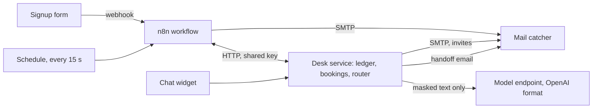

# stepchaser

Onboarding that chases what is missing, appointment reminders, a lead router with handoff and a custom GPT, on n8n.


*A recording of the running stack: n8n, a local mail catcher and the desk page, with made-up partners, clients and leads. The full walkthrough with captions is [docs/recording/walkthrough.mp4](docs/recording/walkthrough.mp4).*

[](https://github.com/Exalt24/stepchaser/actions/workflows/ci.yml) **Proof:** 516 tests, 29 safeguards each broken on purpose and caught, 29 end-to-end checks against a real n8n 2.49.8 and a mail catcher ([run record](docs/proof/onboarding_run.txt)), and a lead router that handed off 34 of the 34 messages that needed a person ([results](docs/proof/router_test_real_openai-gpt-oss-120b.txt)).

## What it is and why

A small business repeats the same jobs by hand: welcome a new partner, chase the documents they have not sent, remind clients of appointments, answer the same questions, and pass the awkward ones to a person. This repository automates those jobs for a made-up tax, credit and funding business (Cedar Lane Services) and measures each one. n8n runs the workflow and sends the emails. A small Python service holds the state, because a check-then-insert inside a workflow can race when two deliveries arrive together.

## What it does

- **Partner onboarding.** A signup form starts an n8n workflow. The partner gets a welcome email with five checklist items, and the team gets a summary. A reminder goes out after 2 days listing only what is still missing, up to 3 times. After the last one the team gets one "stalled" alert and the reminders stop. A retried webhook, a parallel burst or the same email typed in capitals sends nothing twice. If the mail server is down when a reminder is due, the reminder is put back and sent when it returns.
- **Appointment reminders.** A booking is stored in UTC with the client's own time zone. A confirmation with a calendar invite goes out, then reminders 1 day and 2 hours before. A move sends a new invite and re-arms the reminders. A cancel sends one notice and no reminder. A local time that does not exist or happens twice when the clocks change is refused. Everything is tested on a clock the tests move by hand.
- **Lead router with handoff.** A chat answers common questions from a small knowledge base and says which of six services fits. A request for a person, a question about the visitor's own file, a complaint or sensitive numbers go to a person with a short summary and the transcript. Identity and account numbers are masked in code before the model, the logs and the handoff see them.
- **Custom GPT package.** Instructions, four conversation starters and six knowledge files in the shape ChatGPT's GPT builder takes, checked against the builder's limits and scored on 40 cases. [gpt/README.md](gpt/README.md) says how to load it. The same package was also loaded into a private ChatGPT Project on a free account and answered two of the four starters from the uploaded files, with screenshots in [docs/test-runs](docs/test-runs).
- **Team guide.** [docs/SOP.md](docs/SOP.md) is written for a team member who does not code: what runs by itself, the two-minute daily check, what to do when something looks wrong, and how to change an email's wording.

## Measured results

Every number below comes from a run saved in [docs/proof](docs/proof). Intervals are 95 percent Wilson intervals, which are wide at these sample sizes.

**Lead router**, 80 labelled messages written before the first run. The router's prompt was not changed after looking at the test set (it was checked on a separate set of 40). The classifier is called over an OpenAI-compatible endpoint, on two open-weight models in turn. The last column is a keyword stand-in that is not a model.

| Measure | `gpt-oss-120b` | `qwen3.8-27b` | Keyword stand-in |
| --- | --- | --- | --- |
| Routed to the right service, among 46 answerable messages | 44/46 = 0.957 (0.855 to 0.988) | 46/46 = 1.000 (0.923 to 1.000) | 43/46 = 0.935 (0.825 to 0.978) |
| Handoff recall, among 34 that needed a person | 34/34 = 1.000 (0.898 to 1.000) | 31/34 = 0.912 (0.770 to 0.970) | 27/34 = 0.794 (0.632 to 0.897) |
| Handoff precision | 34/36 = 0.944 (0.819 to 0.985) | 31/32 = 0.969 (0.843 to 0.994) | 27/35 = 0.771 (0.610 to 0.879) |
| Answerable messages sent to a person anyway | 2/46 = 0.043 (0.012 to 0.145) | 1/46 = 0.022 (0.004 to 0.113) | 8/46 = 0.174 (0.091 to 0.307) |
| Raw sensitive values found in a prompt or the audit log | 0 | 0 | 0 |

Records: [gpt-oss-120b](docs/proof/router_test_real_openai-gpt-oss-120b.txt), [qwen3.8-27b](docs/proof/router_test_real_qwen-qwen3.8-27b.txt), [stand-in](docs/proof/router_test_standin.txt), each with every case in a `.json` beside it. The three differ in what they get wrong. The stand-in routes well because the test messages use the services' own words, and it misses 7 of 34 handoffs, including every advice question. `gpt-oss-120b` is the cautious one. It handed off all 34, at the price of two answerable messages sent to a person (a collections question it was unsure about and a business loan question whose answer tripped the promise guard), and it sent a documents question and a state question to the general FAQ. `qwen3.8-27b` routed all 46 and missed 3 handoffs: it answered an immigration question, an LLC question and a question about which city the course is held in, each with a confident "we do not handle that" or a general answer, where my labels say a person should take them. In both runs the code floor handed off 22 of the 34 messages before any model call: all 7 with sensitive numbers, 5 of 7 personal-file questions, 5 of 6 complaints and 5 of 6 requests for a person. The model, or a guard after it, took the rest.

**Custom GPT package**, 40 deterministic checks (patterns that must or must not appear, so no second model judges the first), run through an OpenAI-compatible API on `qwen/qwen3.8-27b`. **36 of 40 passed = 0.900 (95% CI 0.769 to 0.960).** Of the 32 original cases 29 passed, and of the 8 added later 7 passed. Services questions were 8 of 8, questions the files cannot answer 3 of 3 and prompt-injection cases 2 of 2. The 4 failures are in [the run record](docs/proof/gpt_eval.txt): a correct but terse answer on reminder timing that missed my 'mention the 2 hour reminder' check, a welcome-note draft that put its refusal note before the draft instead of after it, an answer to a tax-deduction question that was right in substance and missed the words my check wanted, and one real miss: asked what to do when a client types a card number into the chat, it said the answer was not in the guides when `sensitive_info_policy.md` has it. History, because the 32 original cases were used to improve the package: the first run on `openai/gpt-oss-120b` scored 25 of 32 ([record](docs/proof/gpt_eval_first_run.txt)). Five of those misses were mistakes in my checks (typographic apostrophes and non-breaking spaces, a pattern that matched "cannot guarantee") and two were real, where the assistant refused to write a draft when one detail was missing. I changed the instructions and the checks, added 8 cases, and a rerun on the same model scored 32 of 40 with 3 cases lost to a rate limit ([record](docs/proof/gpt_eval_second_run_120b.txt)). That model's daily token allowance then ran out, so the final run is on a different model. Treat the 29 of 32 as a development score and the 8 added cases as the closer to a fresh test, which I had looked at once before correcting the checks.

**Onboarding workflow**, run through n8n's real webhooks and the real mail catcher inbox with a made-up partner list: signup, welcome and summary email, 6 parallel first deliveries creating exactly one partner, retries, a mail server stopped during a reminder and started again, completion, a partner who never answers and is flagged once. Time moves with the desk clock, and the 15 second n8n schedule sends what is due. The full transcript is [docs/proof/onboarding_run.txt](docs/proof/onboarding_run.txt).

**Mutation check.** `scripts/mutation_check.py` breaks one safeguard at a time in the real source (the dedupe, the reminder cap, the cancelled-booking filter, the masking, the handoff floor, the grounding guard and others) and requires the tests to fail. All 29 were caught ([run record](docs/proof/mutation_check_last_run.txt)). Two things came out of earlier runs. One mutant was missed, which showed a guard that was redundant, so I removed the guard and replaced the mutant. Three mutants did not apply at all on Windows line endings and the harness listed them as errors, so it now handles both line endings and fails when any mutant cannot be applied.

## How it fits together



The ledger is a SQLite file with a UNIQUE constraint on the idempotency key and on the email, so the dedupe is one atomic insert. The reminder engine and the router take a clock and a mail sender as arguments, so tests move time and read the outbox. The router's order is fixed: mask, then a code floor that hands off before any model call, then the model's proposal, then code checks (a known route, every price or percentage found in the knowledge base, no promise, enough confidence). Any failure, including a model outage, is a handoff with a reply written in code.

## Run it

You need Docker. A model key is optional: without one the chat uses a labelled keyword stand-in.

```
docker compose up -d --build        # n8n, the mail catcher and the desk; the workflow is imported and published at start
# optional, a real model for the chat: set GROQ_API_KEY (or LLM_API_KEY, LLM_BASE_URL and LLM_MODEL) in your shell first
```

Open http://localhost:8080 for the desk, http://localhost:8025 for the mail catcher (every email lands there, none leave your machine) and http://localhost:5678 for n8n. Stop with `docker compose down`.

## Tests and proofs

```
pip install -r requirements.txt
python -m pytest -q                                    # 516 tests: examples, 400 seeded random worlds, the desk service, the package checks
python scripts/mutation_check.py                       # 29 mutants, about two minutes
python scripts/run_onboarding_proof.py                 # needs the stack running; about six minutes; --quick is the first four sections
python scripts/run_router_eval.py --set test --llm real    # needs a key; --llm standin needs none
python scripts/run_gpt_eval.py                         # needs a key; --validate-only needs none
node scripts/record_demo.cjs                           # re-records the walkthrough against the running stack (needs Playwright)
```

CI runs the tests, the mutation check, the package check and the stand-in router run on every push, plus the first four sections of the onboarding proof against the full stack. It runs on Linux, cancels superseded runs and has a timeout on each job.

## Limits

- The test sets are mine: 80 router messages and 40 package cases, labelled by me from the knowledge base. They show behaviour on this knowledge base, not on a real business's traffic, and the intervals are wide.
- Model answers can differ between runs even at temperature 0. Each score is one run, through one provider's free tier. The router was run on two models and the package on one, because the provider's daily token allowance ran out part way through.
- The `gpt-oss-120b` router run was made before two small edits: the reply cap went from 1500 to 600 tokens, and the handoff summary stopped doubling a final full stop. Neither changes a decision. The `qwen3.8-27b` run and the recording used the final code.
- The package was scored through an OpenAI-compatible API with the knowledge files placed in the prompt. ChatGPT retrieves from uploaded files, so its scores will differ. No custom GPT was published from this repository.
- The emails go to a local mail catcher. Pointing the n8n credential at a real SMTP account is a one-node change that was not run here.
- The reminders are sent by a loop inside the desk process and the ledger is one SQLite file, so this is one instance, not a cluster. A reminder is claimed before it is sent, so a crash between the claim and the send loses that one reminder.
- The desk page has no login and the handoff queue file is not updated by messages a visitor sends after the handoff (the in-memory transcript is).
- The reminder engine is Python, not an n8n workflow. n8n owns onboarding only.
- The recording has captions and no voice.

## Layout

`stepchaser/` the ledger, reminders, router, mask, handoff, package loader and desk service. `n8n/` the generator and the imported workflow. `kb/` the knowledge base. `gpt/` the custom GPT package and its cases. `eval/` the router's labelled messages. `scripts/` the proof, evaluation, mutation and recording runs. `docs/` the team guide, proof records and recording. `tests/` the suite.

Stack: Python 3.13 (standard library only at run time), n8n 2.49.8, Mailpit, SQLite, Docker Compose.

## License

MIT
